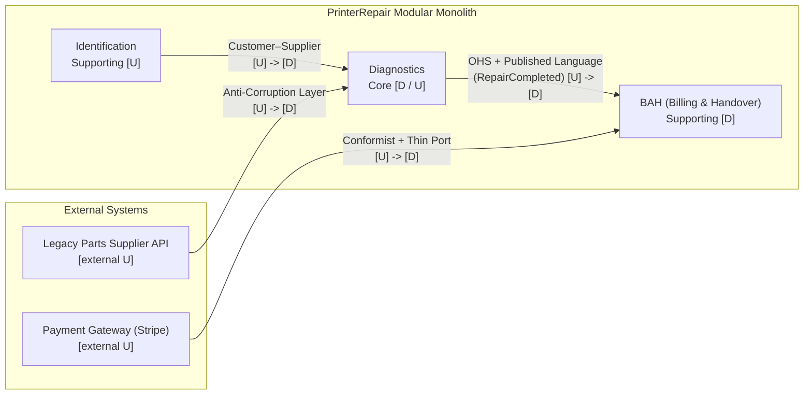
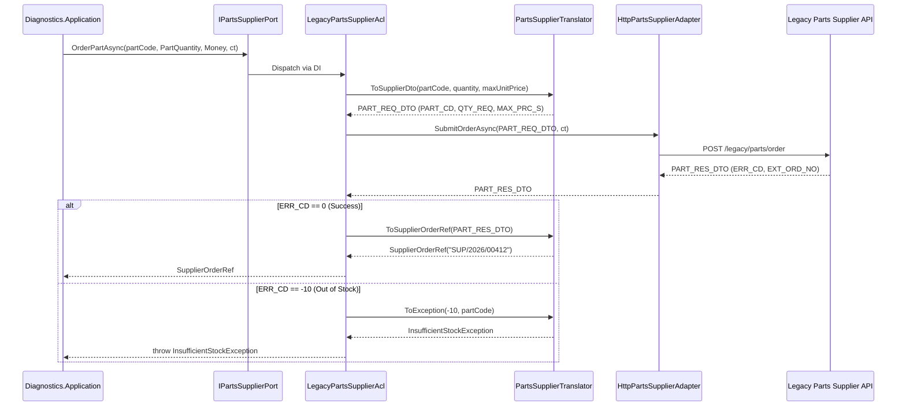

# Context Map & Anti-Corruption Layer Specification

**Project:** Printer Repair System (`Identification`, `Diagnostics`, `BAH`)

---

## Stage 1: Subdomain Classification & Bounded Context Canvas

### 1. Subdomain Classification

| Context | Classification | Main Aggregates (Lab 2) | Business Justification | Module Microarchitecture |
| :--- | :--- | :--- | :--- | :--- |
| **Diagnostics** *(Diagnostics & Repair)* | **Core** | `RepairTicket`, `SparePartsInventory` | Fast, accurate printer diagnostics, strict calibration quality control, and reliable parts reservation are our primary market differentiators and the source of most business rule changes. | **Rich Domain Model + Clean Architecture** – Complex state machine transitions and strict invariants require isolated domain logic and fast database-free unit tests. |
| **Identification** | **Supporting** | `ClientAccount`, `RegisteredPrinter` | Registering clients (with NIP/TaxId validation) and tracking supported printer models is necessary for intake, but it does not differentiate us from competing repair shops. | **Transaction Script / Active Record** – Straightforward intake and lookup operations with few state transitions do not justify full tactical DDD overhead. |
| **BAH** *(Billing & Handover)* | **Supporting** | `ServiceInvoice` | Issuing invoices, enforcing payment before hardware release, and calculating storage fees protect revenue, though standard billing workflows rarely change. | **Transaction Script + Thin Domain Guards** – Simple lifecycle rules (`IsPaid`, 14-day grace period) can be enforced cleanly without a heavy event-sourced architecture. |

### 2. Bounded Context Canvas: `Diagnostics` (Core)

| Section | Details |
| :--- | :--- |
| **1. Name & Purpose** | **Diagnostics:** Manages the end-to-end technical repair lifecycle—from ticket submission and cost estimation to spare part reservation, physical repair, calibration testing, and handover to billing. |
| **2. Strategic Classification** | **Core Subdomain** – High business differentiation, frequent operational rule refinements, built in-house with full DDD and Clean Architecture. |
| **3. Ubiquitous Language** | `RepairTicket` (central work order), `EstimateApproved` (client sign-off to begin work), `CalibrationTest` (mandatory quality gate before completion), `SparePartsInventory` (warehouse stock of components), `PartQuantity` (immutable non-negative stock unit), `HandoverToBilling` (final transition releasing the ticket to BAH). |
| **4. Business Rules (Invariants)** | • A repair cannot be marked `Completed` if the final calibration test fails (`CalibrationFailedException`).<br>• Spare parts cannot be reserved if requested quantity exceeds available unreserved stock (`InsufficientStockException`).<br>• `CompleteRepair()` is forbidden while in `Submitted` state; `ApproveEstimate()` is forbidden once `Completed`. |
| **5. Incoming Communication** | **Commands:** `CreateRepairTicketCommand`, `ApproveEstimateCommand`, `CompleteRepairCommand`, `ReserveSparePartCommand`, `DeleteRepairTicketCommand`.<br>**Queries:** `GetRepairTicketByIdQuery`, `GetAllRepairTicketsQuery`. |
| **6. Outgoing Communication** | **Events (Published Language):** `RepairCompleted` (consumed by `BAH` to issue a `ServiceInvoice`).<br>**Outbound Port:** `IPartsSupplierPort` (orders out-of-stock spare parts from the external supplier). |
| **7. Dependencies** | • **Identification `[U]`:** Customer–Supplier (references `ClientAccountId` and `RegisteredPrinterId`).<br>• **Legacy Parts Supplier API `[external U]`:** Anti-Corruption Layer (`IPartsSupplierPort`). |

---

## Stage 2: Context Map



### Relationship Rationale Table

| Relationship | Pattern | Who Dictates the Model | Why We Chose This Pattern | Main Risk |
| :--- | :--- | :--- | :--- | :--- |
| **Identification `[U]` → Diagnostics `[D]`** | **Customer–Supplier** | Identification (with input from Diagnostics) | Both contexts belong to our team; Diagnostics can request new intake fields (like obsolete model flags) in Identification's backlog. | Scheduling bottleneck if Identification prioritizes other changes. |
| **Diagnostics `[U]` → BAH `[D]`** | **Open Host Service + Published Language** | Diagnostics | Diagnostics publishes a stable, versioned `RepairCompleted` contract containing IDs and cost snapshots so BAH does not couple to `RepairTicket` internals. | Maintaining backward compatibility and versioning when the event schema evolves. |
| **Legacy Parts Supplier API `[U]` → Diagnostics `[D]`** | **Anti-Corruption Layer (ACL)** | External Supplier (isolated at our boundary) | The supplier uses cryptic legacy DTOs (`PART_REQ_DTO`), string-formatted prices, and numeric error codes (`-10`, `-20`). An ACL protects our Core domain from model pollution. | Extra maintenance cost for the translator, adapter, and mapping tests whenever the supplier changes its API. |
| **Payment Gateway (Stripe) `[U]` → BAH `[D]`** | **Conformist (with thin port)** | Stripe | Stripe's API is modern, well-documented, and BAH is a Supporting subdomain; translating its clean model into a custom vocabulary adds no business value. | Dependence on Stripe's release schedule and vocabulary (mitigated by keeping a thin port interface). |

---

## Stage 3: Anti-Corruption Layer Specification (`Diagnostics` ← `Legacy Parts Supplier`)

### 1. ACL Runtime Flow (Success & Error Path)



### 2. Domain Port Contract (`PrinterRepair.Diagnostics.Application/Ports/IPartsSupplierPort.cs`)

```csharp
using PrinterRepair.Diagnostics.Domain.ValueObjects;

namespace PrinterRepair.Diagnostics.Application.Ports;

public sealed record SupplierOrderRef(string ExternalOrderId);

public sealed class PartsSupplierIntegrationException(string message, Exception? innerException = null)
    : Exception(message, innerException);

public interface IPartsSupplierPort
{
    Task<SupplierOrderRef> OrderPartAsync(
        string partCode,
        PartQuantity quantity,
        Money maxUnitPrice,
        CancellationToken cancellationToken = default);
}
```

### 3. Foreign Fields and Error Codes Mapping Table (`PartsSupplierTranslator`)

| Foreign Field / Code (`PART_REQ_DTO` / `PART_RES_DTO`) | Foreign Type | Our Type (`Diagnostics.Domain`) | Translation and Validation Rule |
| :--- | :--- | :--- | :--- |
| `PART_CD` (e.g. `"FUSER-HP-400"`) | `string` | `string` (`partCode`) | Trim whitespace and convert to uppercase (`ToUpperInvariant()`). |
| `QTY_REQ` (e.g. `3`) | `int` | `PartQuantity` (Lab 2 VO) | Pass `quantity.Value`. |
| `MAX_PRC_S` (e.g. `"149.50"`) | `string` | `Money` (Lab 2 VO) | Format as `"F2"` using `CultureInfo.InvariantCulture` (dot separator). Supplier only accepts `"PLN"`; any other currency throws `PartsSupplierIntegrationException`. |
| `EXT_ORD_NO` (e.g. `"SUP/2026/00412"`) | `string` | `SupplierOrderRef` | Mapped when `ERR_CD == 0`. |
| `ERR_CD == 0` | `int` | Success (`SupplierOrderRef`) | No exception thrown. |
| `ERR_CD == -10` | `int` | `InsufficientStockException` (Lab 2 Exception) | Supplier does not have enough stock (`code: "diagnostics.insufficient_stock"`). |
| `ERR_CD == -20` | `int` | `ObsoletePartException` | Part is permanently discontinued (`code: "diagnostics.obsolete_part"`). |
| `ERR_CD` (any other `!= 0`) | `int` | `PartsSupplierIntegrationException` | Technical integration failure; raw error code included only in the technical message. |