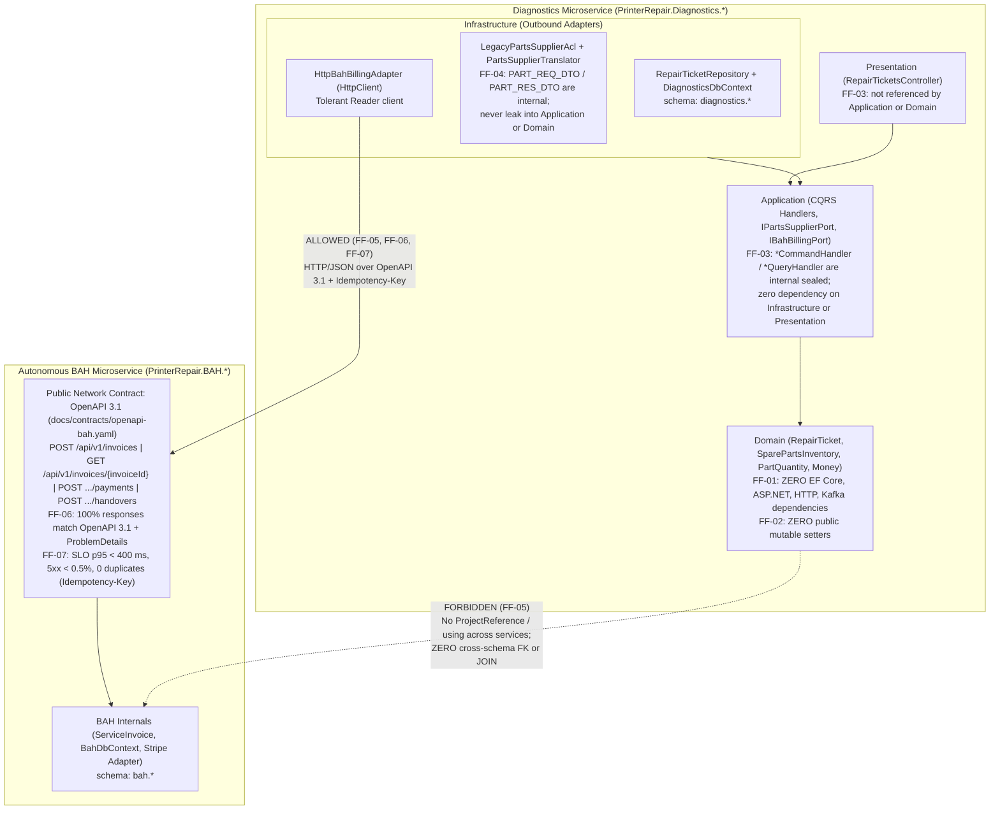

# Architectural Fitness Functions Specification

**Project:** Printer Repair System (`PrinterRepair.Diagnostics`, `PrinterRepair.BAH`, `PrinterRepair.Identification`)  
**Source Specifications:** `docs/architecture/aggregates-and-invariants.md`, `docs/architecture/stateDiagram-RepairTicket.md`, `docs/architecture/context-map.md`, `docs/contracts/openapi-bah.yaml`

---

## Stage 1:

| ID | Guard name | Scope (Layer / Namespace) | Verifiable rule (Technical predicate) | What AI / developer mistake does it stop? | Verification tool |
| :--- | :--- | :--- | :--- | :--- | :--- |
| **FF-01** | Technology purity of the Domain layer | `PrinterRepair.Diagnostics.Domain.*` | No type in `PrinterRepair.Diagnostics.Domain` may depend on namespaces `PrinterRepair.Diagnostics.Application`, `PrinterRepair.Diagnostics.Infrastructure`, `PrinterRepair.Diagnostics.Presentation`, `Microsoft.EntityFrameworkCore`, `Microsoft.AspNetCore`, `System.Net.Http`, or `Confluent.Kafka`. | An AI assistant adds EF Core `[Table]`/`[Column]` attributes, `DbContext`, or ASP.NET/HTTP serialization attributes directly onto `RepairTicket` or `SparePartsInventory`. | `NetArchTest.Rules` in xUnit (`CleanArchitectureGuardTests`) |
| **FF-02** | Encapsulation of invariants in Aggregates and Value Objects | `PrinterRepair.Diagnostics.Domain.Aggregates.*`, `PrinterRepair.Diagnostics.Domain.Entities.*`, `PrinterRepair.Diagnostics.Domain.ValueObjects.*` | No class or record in `PrinterRepair.Diagnostics.Domain` (`RepairTicket`, `SparePartsInventory`, `DiagnosticNote`, `PartQuantity`, `Money`) may declare a property with a public mutable setter (`SetMethod.IsPublic` without `init`-only modifier). All subclasses of `DomainException` must be `sealed`. | AI generates an anemic model with `public TicketStatus Status { get; set; }`, allowing controllers to bypass `IssueEstimate()`, `ApproveEstimate()`, `CompleteRepair()` (calibration test & economic repair guards), `EnsureCanBeDeleted()`, and `PartQuantity`/`Money` non-negative invariants. | `System.Reflection` + xUnit (`CleanArchitectureGuardTests`) |
| **FF-03** | Isolation of the Application layer and CQRS encapsulation | `PrinterRepair.Diagnostics.Application.*` | No type in `PrinterRepair.Diagnostics.Application` may depend on `PrinterRepair.Diagnostics.Infrastructure` or `PrinterRepair.Diagnostics.Presentation`. Every class in `PrinterRepair.Diagnostics.Application` whose name ends with `CommandHandler` or `QueryHandler` (e.g., `CreateRepairTicketCommandHandler`, `IssueEstimateCommandHandler`, `ApproveEstimateCommandHandler`, `CompleteRepairCommandHandler`, `DeleteRepairTicketCommandHandler`, `GetRepairTicketByIdQueryHandler`, `GetAllRepairTicketsQueryHandler`) must be `internal sealed` (non-public). | A controller bypasses `ICommandHandler`/`IQueryHandler` abstractions to inject `RepairTicketRepository` or `DiagnosticsDbContext` directly, or inherits from a handler to alter orchestration logic. | `NetArchTest.Rules` in xUnit (`CleanArchitectureGuardTests`) |
| **FF-04** | Tightness of the Anti-Corruption Layer (ACL) boundary | `PrinterRepair.Diagnostics.Infrastructure.Acl.*` | All types in `PrinterRepair.Diagnostics.Infrastructure.Acl` and `PrinterRepair.Diagnostics.Infrastructure.Acl.ExternalContracts` (`PART_REQ_DTO`, `PART_RES_DTO`, `PartsSupplierTranslator`, `HttpPartsSupplierAdapter`, `LegacyPartsSupplierAcl`) must be `internal`. No type in `PrinterRepair.Diagnostics.Domain` or `PrinterRepair.Diagnostics.Application` (including `IPartsSupplierPort`) may depend on `*.Infrastructure.Acl` or any type ending with `_DTO`. | Foreign supplier contracts (`PART_REQ_DTO`, `PART_CD`, `MAX_PRC_S`, or raw `ERR_CD = -10 / -20`) leak into `IPartsSupplierPort`, CQRS handlers, or domain aggregates. | `NetArchTest.Rules` in xUnit (`CleanArchitectureGuardTests`) |

---

## Stage 2:

### 1. Cross-Microservice Isolation Guard

| ID | Guard name | Scope (Layer / Namespace) | Verifiable rule (Technical predicate) | What AI / developer mistake does it stop? | Verification tool |
| :--- | :--- | :--- | :--- | :--- | :--- |
| **FF-05** | Autonomy and isolation between microservices (code & database) | All projects under `PrinterRepair.Diagnostics.*`, `PrinterRepair.BAH.*`, and `PrinterRepair.Identification.*`; database schemas `diagnostics.*`, `bah.*`, `identification.*` | No type in `PrinterRepair.Diagnostics.*` may reference any namespace starting with `PrinterRepair.BAH` or `PrinterRepair.Identification` (and vice versa—zero cross-service `<ProjectReference>` entries). In the database, microservices share zero tables, zero cross-schema `JOIN` queries, and the SQL fitness query `SELECT COUNT(*) FROM sys.foreign_keys fk JOIN sys.tables pt ON fk.parent_object_id = pt.object_id JOIN sys.tables rt ON fk.referenced_object_id = rt.object_id WHERE pt.schema_id <> rt.schema_id` must return `0`. | Because all microservices live in one `.sln` monorepo, an AI agent adds a direct `<ProjectReference>` from `Diagnostics` to `BAH.Domain` or joins `diagnostics.RepairTickets` with `bah.ServiceInvoices` instead of communicating via the OpenAPI HTTP contract. | `NetArchTest.Rules` in xUnit (`CleanArchitectureGuardTests`) + CI SQL schema fitness check (`sys.foreign_keys`) |

### 2. Dynamic & Contract Fitness Functions

| ID | Guard name & Classification | Scope / Protected Boundary | Verifiable condition & Acceptance threshold (SLO) | When does it run & What happens on violation? | Verification tool |
| :--- | :--- | :--- | :--- | :--- | :--- |
| **FF-06** | OpenAPI 3.1 HTTP Contract Compliance *(Atomic + Dynamic + Triggered)* | Network boundary `/api/v1/invoices/*` exposed by `PrinterRepair.BAH.Presentation` | **100%** of requests and responses (HTTP status codes `200`/`201`/`400`/`404`/`409`/`422`/`503`, required JSON fields, Value Object constraints, required `Idempotency-Key` header on `POST`, and `application/problem+json` `ProblemDetails` envelope with `errorCode`) match `docs/contracts/openapi-bah.yaml`. | Runs automatically in CI on every Pull Request before building or publishing the Docker image; any schema drift fails the build and blocks merge/release. | `WebApplicationFactory` contract/integration tests + Spectral OpenAPI linter |
| **FF-07** | Network Boundary Performance, Reliability & Idempotency *(Holistic + Dynamic + Continuous)* | Synchronous HTTP calls from `PrinterRepair.Diagnostics.Infrastructure` (`HttpBahBillingAdapter`) to `PrinterRepair.BAH.Presentation` (`POST /api/v1/invoices`) | Response latency **p95 < 400 ms**, HTTP **5xx error rate < 0.5%** over a 5-minute rolling window, and **0 duplicate invoices or charges** created when a `POST` request is retried with the same `Idempotency-Key` UUID header. | Verified in CI load/idempotency tests and monitored continuously in production; breaching the SLO triggers an alert and opens the Circuit Breaker (`HTTP 503`). | OpenTelemetry / Prometheus SLO alerts + k6 / xUnit idempotency tests |

### 3. Placement of Architectural Fitness Functions

---

## Contract Versioning & Backward Compatibility Policy

1. **Versioning strategy:** Major contract version is encoded in the URI path (`/api/v1/invoices/...`). Non-breaking additions (e.g., `1.1.0` in `info.version`) remain under `/api/v1/`.
2. **Rule of immutability of `v1`:** Inside `/api/v1/`, only backward-compatible changes are allowed (adding an optional request field with a safe default value, adding a new response property, adding a new endpoint, or relaxing input validation).
3. **No in-place Breaking Changes:** Renaming an existing JSON property, changing a field type, removing a response field, tightening validation constraints, or adding a new `required` request field/header is strictly forbidden in `/api/v1/`. Breaking changes require a parallel `/api/v2/` contract rolled out via **Expand → Migrate/Sunset → Contract**, announcing retirement with `Deprecation: true` and RFC 8594 `Sunset` HTTP headers and retiring `v1` only after 14 consecutive days of zero traffic.
4. **Tolerant Reader rules for the consumer (`PrinterRepair.Diagnostics.Infrastructure`):**
   * `HttpBahBillingAdapter` must silently ignore unknown JSON fields returned by `PrinterRepair.BAH` (never enable `JsonUnmappedMemberHandling.Disallow` on responses).
   * The consumer defines its own private, minimal `internal sealed record` DTOs containing only the fields needed by `Diagnostics` (never share a DTO assembly or `<ProjectReference>` with `BAH`).
   * Enum values (such as `status`) are deserialized as `string?` in the consumer adapter DTO and mapped with a safe default branch (`_ => ...`) so new provider enum values never trigger a `JsonException`.

---

## `AGENTS.md` Rule Mirror

Copy or synchronize the following rules in `/AGENTS.md` so AI coding assistants generate compliant code and `CleanArchitectureGuardTests` directly from this specification:

* **FF-01:** Never add EF Core, ASP.NET Core, `System.Net.Http`, or message broker references to any `*.Domain` project.
* **FF-02:** Never add `public set` to any property in `*.Domain`; mutate state exclusively through domain methods and keep all `DomainException` subclasses `sealed`.
* **FF-03:** Never reference `*.Infrastructure` or `*.Presentation` from `*.Application`; declare all `*CommandHandler` and `*QueryHandler` classes as `internal sealed` and register them via an Application DI extension method.
* **FF-04:** Keep all external DTOs (`*_DTO`), translators, and adapters `internal sealed` inside `*.Infrastructure.Acl`; never expose them through ports in `*.Application`.
* **FF-05:** Never add `<ProjectReference>` entries, namespace imports, cross-schema `FOREIGN KEY`s, or SQL `JOIN`s between `PrinterRepair.Diagnostics.*`, `PrinterRepair.BAH.*`, and `PrinterRepair.Identification.*`.
* **FF-06 / FF-07:** Generate `PrinterRepair.BAH` controllers and `PrinterRepair.Diagnostics` HTTP adapters strictly from `docs/contracts/openapi-bah.yaml`, enforce `Idempotency-Key` on all `POST` endpoints, and run `dotnet test` after every edit.