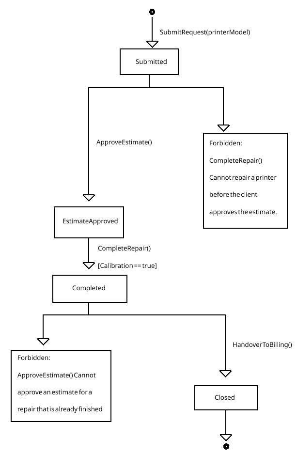

## Task 2

## 1. Lifecycle State Machine (RepairTicket)
A `RepairTicket` moves through several stages, from the initial diagnosis to repair completion. Each operation is only allowed at the appropriate stage, which helps prevent invalid actions during the repair process.



## 2. Catalog of Business Invariants
These aren't just simple validations such as 'this field can't be blank'. The system enforces business rules and it's very difficult to accidentally circumvent them.

| Domain / Aggregate | Business rule (Invariant) | Reaction to violation (Domain exception) |
| :--- | :--- | :--- |
| **Diagnostics** / **RepairTicket** | A repair cannot be marked as Completed if the final calibration test fails. | `CalibrationFailedException` |
| **Diagnostics** / **SparePartsInventory** | The system cannot reserve a spare part if the requested quantity exceeds the currently available, unreserved stock. | `InsufficientStockException` |
| **BAH** / **ServiceInvoice** | The repaired printer equipment cannot be released to the client until the invoice is fully paid (`IsPaid == true`). | `UnpaidInvoiceReleaseException` |
| **BAH** / **ServiceInvoice** | A daily storage fee cannot be applied if fewer than 14 free days have passed since the repair was completed. | `PrematureStorageFeeException` |
| **Identification** / **RegisteredPrinter** | A printer cannot be assigned to a client account if the model is on the permanently obsolete list. | `ObsoletePrinterModelException` |

## 3. Given–When–Then Scenarios (TDD Specifications)

**Positive Scenarios:**

*Successful Repair Completion*
- Given: `RepairTicket` tic-1 is in `EstimateApproved` state.
- When: The `CompleteRepair` command is run with a passing calibration test (`true`).
- Then the ticket's state changes to `Completed`.

*Processing Full Payment*
- Given: `ServiceInvoice` inv-2 is issued with a `TotalAmount` of 150 PLN and `IsPaid` is `false`.
- When: the `PAY` command is issued with exactly 150 PLN.
- The the invoice status updates to paid (`IsPaid = true`)

**Negative Scenarios:**

*Failing Calibration Test*
- Given: `RepairTicket` tic-3 is in `EstimateApproved` state.
- When: The `CompleteRepair` command is run with a failing calibration test (`false`).
- Then the aggregate throws a `CalibrationFailedException` and the ticket remains in the `EstimateApproved` state.

*Blocking Early Equipment Release*
- Given: `ServiceInvoice` inv-4 has been issued and is active, `IsPaid` is still `false`.
- When: the `ReleaseEquipment` command is issued.
- Then the aggregate throws an `UnpaidInvoiceReleaseException`, the equipment remains unreleased, and the invoice state remains unchanged.

## 4. GoF Design Pattern in the Domain
**Pattern Used:** Factory Method
**In:** `ServiceInvoice`

We use a static factory method to create `ServiceInvoice` instances. Instead of allowing other parts of the application to create invoices directly, the Issue() method controls the creation process. It checks that the invoice amount is valid, generates a new ID and ensures that the invoice starts with `IsPaid` = `false`.

```csharp
public static ServiceInvoice Issue(Guid ticketId, decimal totalCost)
{
    if (totalCost <= 0) 
        throw new InvalidInvoiceAmountException();

    return new ServiceInvoice 
    {
        Id = Guid.NewGuid(),
        RepairTicketId = ticketId,
        TotalAmount = totalCost,
        IsPaid = false
    };
}
```